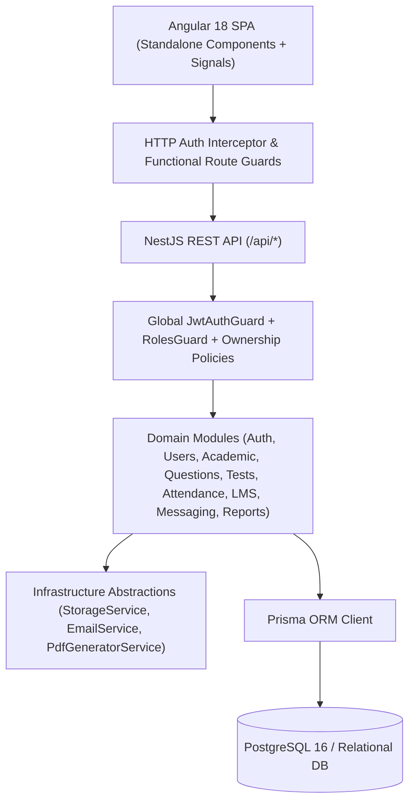

# System Architecture — EduNexus Platform

## 1. High-Level Overview

EduNexus follows a modular, layered architecture separating presentation (Angular 18 SPA), business logic & authorization (NestJS modular services & guards), infrastructure providers (Storage, Email, PDF generation), and persistence (Prisma ORM + PostgreSQL/SQLite).

---

## 2. Backend Modular Architecture (`backend/src`)

- **`common/`**:
  - `decorators/`: `@Roles(...)`, `@Public()`, `@CurrentUser()`
  - `guards/`: `JwtAuthGuard` (verifies Bearer access tokens), `RolesGuard` (enforces role hierarchy)
  - `filters/`: `AllExceptionsFilter` (normalizes HTTP errors, maps Prisma unique/not-found errors, prevents stack trace leakage)
  - `dto/`: `PaginationQueryDto` and `buildPaginatedResponse()` for server-side pagination
- **`providers/`**:
  - `StorageService`: Pluggable file storage supporting `local`, `s3`, `r2`, `gcs`, and `azure` drivers with strict MIME-type and file-size validation.
  - `EmailService`: Pluggable transactional email abstraction (`console`, `smtp`, `sendgrid`) for welcome, password reset, test assignment, and result notifications.
- **`modules/`**:
  - `auth`: Login (email/username/phone), SHA-256 hashed refresh token rotation, account lockout on repeated failed attempts, password reset & change.
  - `users`, `students`, `teachers`, `parents`: Profile lifecycle, auto-generated `studentCode` (`EDU-2026-XXXX`), parent-child linking, and strict ownership verification.
  - `academic`: Courses, Subjects, Chapters, Topics, Classes/Batches, and Timetable slots.
  - `questions`: Question Bank CRUD, Subject → Chapter → Topic → Difficulty organization, usage & accuracy statistics, and validated CSV bulk import.
  - `tests`: Manual & Automatic Test Generation, test assignment with notifications, exam attempt recovery, 15-second periodic auto-save, objective auto-evaluation engine, subjective grading, and rank computation.
  - `attendance`: Session attendance marking, bulk-present helper, absence notifications, and monthly/batch aggregation.
  - `messaging` & `notifications`: Role-scoped internal chat and in-app notification center.
  - `lms`: Targeted announcements, study materials, homework assignments/submissions, and categorized teacher feedback.
  - `reports`: Executive admin analytics, student progress analytics, CSV exports, and `PdfGeneratorService` (`pdfkit`).
  - `settings` & `audit-logs`: Dynamic center branding, public website API, global debounced search, and administrative audit trail.

---

## 3. Frontend Architecture (`frontend/src/app`)

- **State Management with Angular Signals**:
  - `AuthService` manages `currentUser`, `isAuthenticated`, `userRole`, and `selectedChildId` (for the Parent Multi-Child Switcher) reactively without heavy boilerplate.
  - `ToastService` manages non-blocking toast notifications and confirmation modals for destructive actions.
- **Security & Routing**:
  - Functional `authGuard` and `roleGuard([...])` protect routes before component instantiation.
  - `authInterceptor` attaches JWT Bearer tokens and automatically rotates expired access tokens using the refresh token endpoint.
