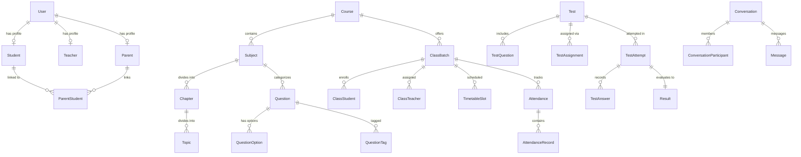

# Database Design & Schema Reference — EduNexus Platform

## 1. Entity-Relationship Overview

The relational database consists of **29 normalized models** managed via Prisma ORM (`backend/prisma/schema.postgresql.prisma` for PostgreSQL 16 and `backend/prisma/schema.prisma` for local development).

---

## 2. Core Tables & Indexing Strategy

| Model | Primary Key | Key Unique Constraints & Composite Indexes |
| :--- | :--- | :--- |
| `User` | `id` (UUID) | `@unique(email)`, `@unique(username)`, `@@index([role, status])` |
| `Role`, `Permission`, `RolePermission` | `id` (UUID) | `@@unique([roleId, permissionId])` |
| `RefreshToken`, `PasswordResetToken` | `id` (UUID) | `@unique(tokenHash)`, `@@index([userId])` |
| `Student` | `id` (UUID) | `@unique(userId)`, `@unique(studentCode)`, `@@index([grade])` |
| `Teacher` | `id` (UUID) | `@unique(userId)`, `@unique(employeeCode)` |
| `Parent`, `ParentStudent` | `id` (UUID) | `@@unique([parentId, studentId])` |
| `Course`, `Subject`, `Chapter`, `Topic` | `id` (UUID) | `@unique(code)`, `@@index([subjectId])`, `@@index([chapterId])` |
| `ClassBatch`, `ClassTeacher`, `ClassStudent` | `id` (UUID) | `@@unique([classBatchId, studentId])`, `@@unique([classBatchId, teacherId, subjectId])` |
| `TimetableSlot` | `id` (UUID) | `@@index([classBatchId, dayOfWeek])`, `@@index([teacherId, dayOfWeek])` |
| `Question`, `QuestionOption`, `QuestionTag` | `id` (UUID) | `@@index([subjectId, difficulty, type])`, `@@unique([questionId, tag])` |
| `Test`, `TestQuestion`, `TestAssignment` | `id` (UUID) | `@unique(code)`, `@@unique([testId, questionId])`, `@@index([status, subjectId])` |
| `TestAttempt`, `TestAnswer`, `Result` | `id` (UUID) | `@@unique([testId, studentId, attemptNumber])`, `@@unique([attemptId, questionId])`, `@@index([testId, obtainedMarks])` |
| `Attendance`, `AttendanceRecord` | `id` (UUID) | `@@unique([classBatchId, dateString])`, `@@unique([attendanceId, studentId])` |
| `Conversation`, `ConversationParticipant`, `Message` | `id` (UUID) | `@@unique([conversationId, userId])`, `@@index([conversationId, createdAt])` |
| `Notification`, `Announcement` | `id` (UUID) | `@@index([userId, isRead, createdAt])`, `@@index([targetScope, publishDate])` |
| `StudyMaterial`, `Assignment`, `AssignmentSubmission` | `id` (UUID) | `@@unique([assignmentId, studentId])`, `@@index([classBatchId, dueDate])` |
| `TeacherFeedback` | `id` (UUID) | `@@index([studentId, category])` |
| `AuditLog`, `SystemSetting`, `PublicEnquiry` | `id` (UUID) | `@@index([action, createdAt])`, `@unique(key)` |
